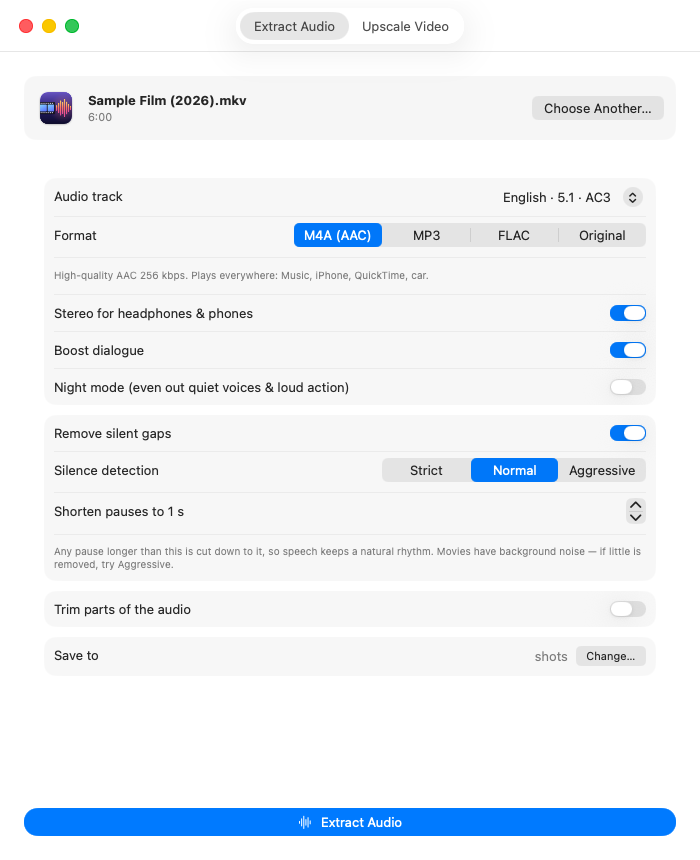
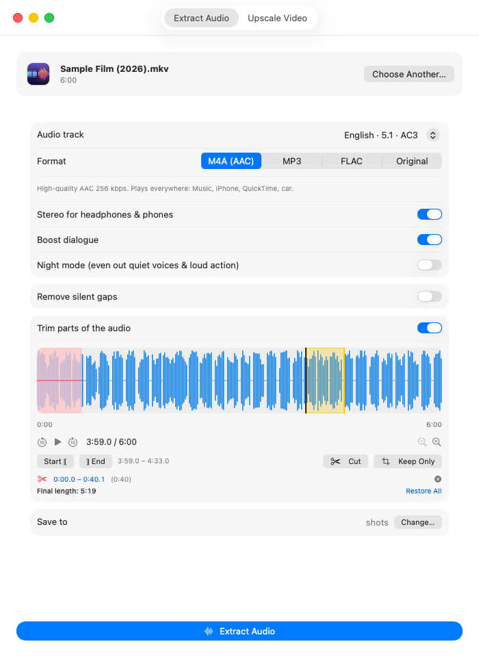
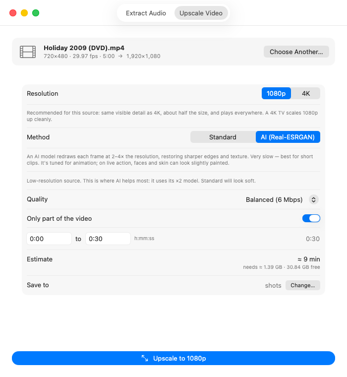

# Movie Audio

A small native macOS app for two jobs:

- **Extract Audio** — pull the soundtrack out of a movie so you can listen to the dialogue and score on their own, on headphones, in the car, or on your phone.
- **Upscale Video** — enlarge 480p, 720p or 1080p video to 1080p or 4K, with either a fast standard resize or AI upscaling (Real-ESRGAN).

Built with SwiftUI. All processing happens locally on your Mac.

<p align="center">
  
  
  
</p>

<sub>Screenshots use generated test media (ffmpeg test patterns and synthetic audio) and fictional titles.</sub>

## Why Movie Audio?

I built this for two things I actually do.

### Great movies are worth listening to

Some films carry a screenplay so strong — the dialogue, the performances, the score — that you can enjoy them without the picture at all. I listen to them while driving. It beats the boredom of a long drive, and because it's audio only, my eyes stay on the road. A movie I already love becomes something closer to a radio drama.

Movie soundtracks aren't made for car speakers, though, so the audio features exist to fix that:

- **Boost dialogue** — in a surround mix, voices sit in the centre channel and get buried when folded down to stereo. Lifting that channel keeps every line clear over road noise.
- **Night mode** — whispers that vanish and explosions that make you jump for the volume knob are a bad combination at 70 mph. This evens them out.
- **Remove silent gaps** — long stretches where only the picture tells the story are dead air without it. Shortening them keeps the story moving.
- **Trim** — cut opening logos, end credits, or a scene that only works on screen.

### Old DVDs deserve a big screen

I have a shelf of DVDs I still love, and a 150" projector screen that shows every flaw in them. DVD video is 480p; blown up to that size it looks soft, blocky and, for interlaced discs, full of combing lines.

The upscaler is built to make those discs watchable again:

- **Deinterlacing, correct aspect ratio and colour** — DVD quirks (interlaced fields, non-square pixels, older colour standards) are handled automatically, so the picture isn't stretched, striped or off-colour.
- **AI upscaling** — Real-ESRGAN restores sharper edges and cleaner texture than a plain resize, which matters most on low-resolution sources at big-screen size.
- **Honest defaults and estimates** — 480p sources default to 1080p, because 4K adds no real detail for them, and the app tells you how long a job will take and how much disk it needs before you start.

## Features

### Extract Audio
- Choose any audio track in the file (language, commentary, 5.1, stereo…).
- Save as **M4A (AAC)**, **MP3**, **FLAC**, or the **original** stream copied without re-encoding.
- **Stereo for headphones**: folds 5.1/7.1 surround down to stereo.
- **Boost dialogue**: lifts the centre channel, where speech lives in surround mixes, during the downmix.
- **Night mode**: evens out quiet dialogue and loud action scenes.
- **Remove silent gaps**: shortens long pauses to a length you choose, so speech keeps a natural rhythm.
- **Trim editor**: waveform with playback and zoom. Drag to select, then **Cut** or **Keep Only**; preview playback skips the cut parts. Shortcuts: <kbd>Space</kbd> play/pause, <kbd>I</kbd>/<kbd>O</kbd> set selection start/end, <kbd>Delete</kbd> cut.
- Keeps chapters and metadata, unless the timeline is edited by trimming or silence removal.

### Upscale Video
- **Standard**: high-quality Lanczos resize plus contrast-adaptive sharpening, encoded to HEVC with the Mac's hardware encoder. Fast enough for full-length movies.
- **AI (Real-ESRGAN)**: redraws each frame at 2×, 3× or 4×, depending on the source. Much slower, so it's best for short clips. Supports a start/end range.
- **1080p or 4K target**: defaults to 1080p for 480p/720p sources, where 4K adds no visible detail.
- Handles DVD-style sources: non-square pixels (correct aspect ratio), interlacing (deinterlaced with `bwdif`), and SD colour (BT.601 → BT.709).
- Shows time and disk-space estimates before you start, keeps the Mac awake while running, and copies the original audio tracks.

#### Speed on an Apple M1 (measured)

| Job | Time per minute of video |
|---|---|
| Standard, 480p → 1080p | ~0.5 min |
| Standard, 1080p → 4K | ~1.4 min |
| AI, 480p → 1080p | ~15–20 min |
| AI, 1080p → 4K | ~1.5 h |

Newer Apple Silicon chips will be faster.

## Requirements

- macOS 14 or later, Apple Silicon
- [FFmpeg](https://ffmpeg.org) installed with Homebrew: `brew install ffmpeg`
- AI upscaling only: the app offers a one-time download of the Real-ESRGAN engine (≈50 MB) into `~/Library/Application Support/MovieAudio/`.

## Build

No Xcode project is needed; the Swift command-line tools are enough.

```bash
./build.sh            # builds build/MovieAudio.app
./build.sh --install  # also copies it to /Applications
```

The app icon is drawn in code. To regenerate it, run `swift Icon/make_icon.swift Icon/icon_1024.png` and rebuild `Icon/AppIcon.icns` with `iconutil`.

## Project layout

```
Sources/MovieAudioApp.swift   App entry, tabs, Extract Audio model + UI
Sources/TrimEditor.swift      Waveform analysis, preview playback, cut editing
Sources/Upscaler.swift        Upscale Video model, pipelines + UI
Icon/                         Icon generator, PNG and .icns
build.sh                      Compiles and packages the .app bundle
```

## Third-party software

Movie Audio does not bundle or redistribute any third-party code. It runs these tools, which you install or download separately:

- **FFmpeg**: used as an external command-line tool for all decoding, filtering and encoding. FFmpeg is licensed under the LGPL/GPL; see [ffmpeg.org/legal.html](https://ffmpeg.org/legal.html).
- **Real-ESRGAN** (`realesrgan-ncnn-vulkan` and the `realesr-animevideov3` model): downloaded on demand from the [official GitHub release](https://github.com/xinntao/Real-ESRGAN/releases/tag/v0.2.5.0). © Xintao Wang, licensed under the [BSD 3-Clause License](https://github.com/xinntao/Real-ESRGAN/blob/master/LICENSE).

The app icon is original artwork generated by `Icon/make_icon.swift`.

## Responsible use

Use Movie Audio only with videos you own or have the right to use. Extracting or upscaling content for personal use may be allowed where you live, but redistributing copyrighted films, soundtracks, or upscaled copies generally is not.

Movie Audio does **not** remove or bypass DRM or other copy protection. Protected files, such as streaming downloads or purchased iTunes movies, will not open.
